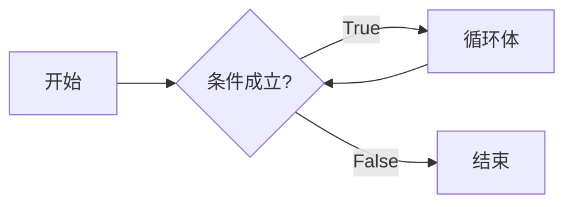

# 顺序结构

顺序结构指程序按照代码顺序从上到下执行，每条语句依次执行，不发生分支或循环跳转。

# 分支结构

## `if` 语句

`if` 根据条件表达式的真值决定是否执行代码块。条件表达式后使用冒号 `:`，代码块通过缩进表示。

语法形式：

```python
if 条件表达式:
    ...
elif 条件表达式:
    ...
else:
    ...
```

- `elif` 可以有零个或多个。
- `else` 可以省略。
- 条件从上到下依次判断，执行第一个为真的分支后结束整个 `if` 结构。
- 条件判断使用真值测试，不要求表达式本身返回 `True` 或 `False`。

代码示例：

```python
temperature = 25
if temperature > 20:
    print("天气较热，请穿凉爽的衣服。")

name = "admin"
password = "123456"
if name == "admin" and password == "123456":
    print("登录成功")
else:
    print("登录失败")

score = 80
if score >= 90:
    print("优秀")
elif score >= 80:
    print("良好")
elif score >= 60:
    print("及格")
else:
    print("不及格")

# 输出结果：
# 天气较热，请穿凉爽的衣服。
# 登录成功
# 良好
```

Python 没有 `switch` 关键字；简单的多分支判断通常使用 `if...elif...else`。

## `match...case` 语句

Python 3.10 引入 `match...case`。它是模式匹配语句，不只是 `switch` 的改名，适合把一个对象与多个固定值或结构进行匹配。

语法形式：

```text
match 表达式:
    case 模式1:
        ...
    case 模式2 if 守卫条件:
        ...
    case 模式3 | 模式4:
        ...
    case _:
        ...
```

匹配规则：

- 按 `case` 的书写顺序匹配，只执行第一个匹配成功的分支。
- `_` 是通配模式，可以匹配任意值，通常放在最后。
- `|` 表示多个模式中的任意一个。
- `if` 守卫条件会在模式匹配成功后继续判断。
- 如果没有匹配成功的 `case`，则不执行任何分支。

代码示例：

```python
def http_error(status):
    match status:
        case 400:
            return "Bad request"
        case 404:
            return "Not found"
        case 418:
            return "I'm a teapot"
        case _:
            return "Something's wrong with the internet"


print(http_error(400))

# 输出结果：
# Bad request
```

多个值可以合并到同一个模式：

```python
def permission_error(status):
    match status:
        case 401 | 403 | 404:
            return "Not allowed"
        case _:
            return "Unknown status"


print(permission_error(403))

# 输出结果：
# Not allowed
```

# 循环结构

循环用于重复执行一段代码。Python 常用两种循环：

- `while`：循环次数或结束条件由条件表达式决定。
- `for`：遍历可迭代对象中的元素。

循环流程：



## `while` 循环

`while` 在每次循环开始前判断条件。条件为真时执行循环体，否则结束循环。

语法形式：

```python
while 条件表达式:
    ...
```

循环体通常需要更新条件相关的变量，否则可能形成无限循环。

代码示例：

```python
# 输出 5 次 "Hello, World!"
count = 0
while count < 5:
    print("Hello, World!")
    count += 1

# 计算 1 到 5 的和
i = 1
total = 0
while i <= 5:
    total += i
    i += 1

print(f"total = {total}")

# 输出结果：
# Hello, World!
# Hello, World!
# Hello, World!
# Hello, World!
# Hello, World!
# total = 15
```

### `while` 循环嵌套

循环可以嵌套使用，内层循环会在每次外层循环迭代时重新执行。

示例 1：输出 3 行 6 列：

```python
i = 1
while i <= 3:
    j = 1
    while j <= 6:
        print(f"第{i}排第{j}列", end="\t")
        j += 1
    print()
    i += 1

# 输出结果：
# 第1排第1列    第1排第2列    第1排第3列    第1排第4列    第1排第5列    第1排第6列
# 第2排第1列    第2排第2列    第2排第3列    第2排第4列    第2排第5列    第2排第6列
# 第3排第1列    第3排第2列    第3排第3列    第3排第4列    第3排第5列    第3排第6列
```

示例 2：输出九九乘法表：

```python
i = 1
while i <= 9:
    j = 1
    while j <= i:
        print(f"{i} * {j} = {i * j}", end="  ")
        j += 1
    print()
    i += 1

# 输出结果：
# 1 * 1 = 1
# 2 * 1 = 2  2 * 2 = 4
# 3 * 1 = 3  3 * 2 = 6  3 * 3 = 9
# 4 * 1 = 4  4 * 2 = 8  4 * 3 = 12  4 * 4 = 16
# 5 * 1 = 5  5 * 2 = 10  5 * 3 = 15  5 * 4 = 20  5 * 5 = 25
# 6 * 1 = 6  6 * 2 = 12  6 * 3 = 18  6 * 4 = 24  6 * 5 = 30  6 * 6 = 36
# 7 * 1 = 7  7 * 2 = 14  7 * 3 = 21  7 * 4 = 28  7 * 5 = 35  7 * 6 = 42  7 * 7 = 49
# 8 * 1 = 8  8 * 2 = 16  8 * 3 = 24  8 * 4 = 32  8 * 5 = 40  8 * 6 = 48  8 * 7 = 56  8 * 8 = 64
# 9 * 1 = 9  9 * 2 = 18  9 * 3 = 27  9 * 4 = 36  9 * 5 = 45  9 * 6 = 54  9 * 7 = 63  9 * 8 = 72  9 * 9 = 81
```

## `for` 循环

`for` 依次取出可迭代对象中的元素。常见可迭代对象包括字符串、列表、元组、集合、字典和 `range` 对象。

语法形式：

```python
for 变量 in 可迭代对象:
    ...
```

代码示例：

```python
text = "ABCDE"
for char in text:
    print(char)

# 输出结果：
# A
# B
# C
# D
# E
```

整数和浮点数本身不是可迭代对象，不能直接用于 `for`：

```python
for i in 123:
    print(i)

# TypeError: 'int' object is not iterable
```

### `range()` 函数

`range()` 返回一个表示等差整数序列的 `range` 对象，常用于控制循环次数。它不会立即创建完整列表，因此适合遍历较大的整数范围。

语法形式：

```text
range(stop)
range(start, stop)
range(start, stop, step)
```

- `start`：起始值，省略时默认为 `0`。
- `stop`：结束边界，不包含该值。
- `step`：步长，省略时默认为 `1`，不能为 `0`。
- `step` 为负数时可以倒序生成序列。

代码示例：

```python
for i in range(5):          # 0、1、2、3、4
    print(i)

for i in range(1, 6):       # 1、2、3、4、5
    print(i)

for i in range(1, 10, 3):   # 1、4、7
    print(i)

for i in range(5, 0, -1):   # 5、4、3、2、1
    print(i)
```

如需查看具体元素，可以显式转换为列表；直接打印 `range` 得到的是对象表示：

```python
print(range(3))
print(list(range(3)))

# 输出结果：
# range(0, 3)
# [0, 1, 2]
```

示例：使用 `for` 循环计算 1 到 100 的和：

```python
total = 0
for i in range(1, 101):
    total += i

print(f"total = {total}")

# 输出结果：
# total = 5050
```

示例：使用 `for` 循环输出 3 行 6 列：

```python
for i in range(1, 4):
    for j in range(1, 7):
        print(f"第{i}排第{j}列", end="\t")
    print()

# 输出结果：
# 第1排第1列    第1排第2列    第1排第3列    第1排第4列    第1排第5列    第1排第6列
# 第2排第1列    第2排第2列    第2排第3列    第2排第4列    第2排第5列    第2排第6列
# 第3排第1列    第3排第2列    第3排第3列    第3排第4列    第3排第5列    第3排第6列
```

# 流程控制

## `break` 与 `continue`

两者只能在循环内部使用，通常与 `if` 配合：

- `break`：立即结束最近的一层循环，继续执行循环后的代码。
- `continue`：跳过本次循环剩余代码，进入下一次迭代。
- 嵌套循环中，`break` 只影响当前所在的那一层循环。

错误示例：

```text
i = 1
if i < 3:
    print("哈哈哈")
    break  # SyntaxError: 'break' outside loop
```

示例 1：`break`：

```python
for i in range(1, 6):
    print(f"吃第{i}个苹果")
    if i == 3:
        break

# 输出结果：
# 吃第1个苹果
# 吃第2个苹果
# 吃第3个苹果
```

示例 2：`continue`：

```python
for i in range(1, 6):
    if i == 3:
        print(f"第{i}个苹果有虫子，不吃了")
        continue
    print(f"吃第{i}个苹果")

# 输出结果：
# 吃第1个苹果
# 吃第2个苹果
# 第3个苹果有虫子，不吃了
# 吃第4个苹果
# 吃第5个苹果
```

在 `while` 中使用 `continue` 时，必须确保下一次循环前仍会更新控制变量，否则可能导致无限循环。

## 循环的 `else` 子句

`for` 和 `while` 都可以使用 `else`。只有循环没有执行 `break` 并正常结束时，才执行 `else`；如果通过 `break`、`return` 或异常离开循环，则不会执行。

### `while...else`

```python
count = 1
while count <= 5:
    print(f"这是第 {count} 次循环")
    count += 1
else:
    print("循环正常结束")

# 输出结果：
# 这是第 1 次循环
# 这是第 2 次循环
# 这是第 3 次循环
# 这是第 4 次循环
# 这是第 5 次循环
# 循环正常结束
```

### `for...else`：搜索场景

```python
target = 3

for number in [1, 2, 4, 5]:
    if number == target:
        print("找到目标")
        break
else:
    print("没有找到目标")

# 输出结果：
# 没有找到目标
```

## `pass` 语句

`pass` 不执行任何操作，只用于需要语句但暂时不实现逻辑的代码块：

```python
def pending_feature():
    pass


class Empty:
    pass
```

## 循环中的常用技巧

### 使用 `enumerate()` 获取索引

需要同时获取索引和值时，优先使用 `enumerate()`，不要手动维护计数器：

```python
items = ["Python", "FastAPI", "SQLAlchemy"]

for index, item in enumerate(items, start=1):
    print(index, item)

# 输出结果：
# 1 Python
# 2 FastAPI
# 3 SQLAlchemy
```

### 使用 `zip()` 并行遍历

`zip()` 将多个可迭代对象按位置组合；默认以最短对象的长度为准：

```python
names = ["张三", "李四", "王五"]
scores = [90, 85, 95]

for name, score in zip(names, scores):
    print(f"{name}: {score}")

# 输出结果：
# 张三: 90
# 李四: 85
# 王五: 95
```

### 遍历字典

遍历字典时，直接遍历得到键；需要键和值时使用 `.items()`：

```python
user_scores = {"张三": 90, "李四": 85}

for name, score in user_scores.items():
    print(name, score)

# 输出结果：
# 张三 90
# 李四 85
```

不要在遍历字典或列表的同时直接增删其元素。可以遍历副本，或创建新的容器：

```python
users = {"张三": "active", "李四": "inactive"}

for user, status in users.copy().items():
    if status == "inactive":
        del users[user]

print(users)

# 输出结果：
# {'张三': 'active'}
```
