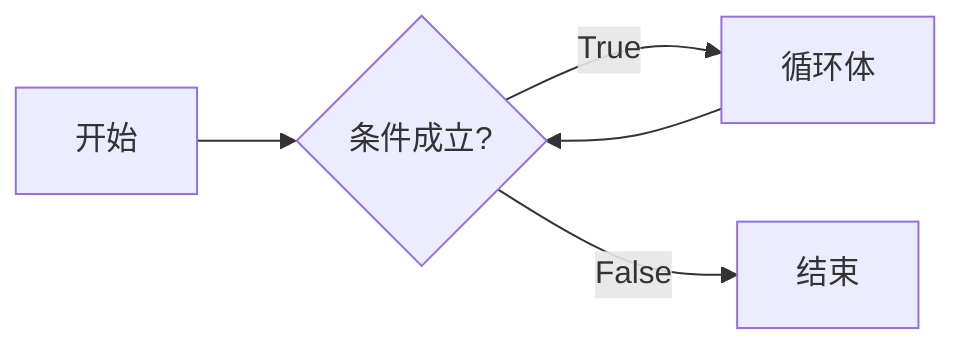

# 顺序结构

顺序结构指程序按代码顺序从上到下依次执行，每条语句依次执行，不发生跳转。

# 分支结构

## `if` 语句

Python 条件语句根据条件表达式的结果（`True` 或 `False`）决定是否执行代码块。

语法形式：

```python
if 条件表达式1:
    ...
elif 条件表达式2:
    ...
else:
    ...
```

代码示例：

```python
# if 语句
temperature = 25
if temperature > 20:
    print('天气较热，请穿凉爽的衣服。')

# if-else 语句
name = 'admin'
password = '123456'
if name == 'admin' and password == '123456':
    print('🟢 登录成功')
else:
    print('🔴 登录失败')

# if-elif-else
score = 80
if score >= 90:
    print('优秀')
elif score >= 80:
    print('良好')
elif score >= 60:
    print('及格')
else:
    print('不及格')
```

> **提示**：在 Python 中，没有 `switch` 语句的概念。

Python 中用 **elif** 代替了 **else if**，所以 `if` 语句的关键字为：**if – elif – else**。

> **注意**：
>
> - 每个条件后面要使用冒号 **:**，表示接下来是满足条件后要执行的语句块。
> - 使用缩进来划分语句块，相同缩进数的语句在一起组成一个语句块。
> - 在 Python 中没有 **switch...case** 语句，但 Python 3.10 添加了 **match...case**，功能也类似，详见下文。

## `match...case` 语句

Python 3.10 增加了 **match...case** 语句，可以在某些场景下替代一连串的 **if-else** 判断。

`match` 后的对象会依次与 `case` 后的模式进行匹配。匹配成功后执行对应的代码块；`_` 可以匹配任意值。

语法格式如下：

```python
match expression:
    case 1:
        ...
    case 2 if condition:
        ...
    case 3 | 4:
        ...
    case _:
        ...
```

代码示例：

```python
def http_error(status):
    match status:
        case 400:
            return "Bad request"
        case 404:
            return "Not found"
        case 418:
            return "I'm a teapot"
        case _:
            return "Something's wrong with the internet"


print(http_error(400))  # Bad request
```

一个 `case` 也可以设置多个匹配条件，条件使用 `|` 隔开，例如：

```python
def permission_error(status):
    match status:
        case 401 | 403 | 404:
            return "Not allowed"
```

# 循环结构

循环就是重复执行某段代码。在编写程序时，如果需要重复输出某段内容或重复处理数据，可以使用循环结构来减少重复代码。

循环流程：



在每次循环之前，程序都会计算循环条件。如果条件为真（`True`），就执行循环体；执行完毕后回到条件判断处重新计算。条件为假（`False`）时，循环结束，程序继续执行循环之后的代码。

## `while`

`while` 循环是一种基本的循环控制结构，它允许程序在满足特定条件时重复执行一段代码块。这个条件在每次循环开始前都会进行评估，如果条件为真（`True`），则执行循环体内的语句；如果条件为假（`False`），则退出循环，继续执行循环之后的代码。

语法形式：

```python
while 条件表达式:
    ...
```

代码示例：

```python
# 需求：输出 5 次 "Hello, World!"
# 定义变量保存次数，初始值为 0
count = 0

# 设置循环条件：次数小于 5
while count < 5:
    # 输出 "Hello, World!"
    print("Hello, World!")
    # 次数加 1
    count += 1


# 需求：计算 1-5 的和
# 定义变量保存初始值
i = 1
# 定义变量保存总和
total = 0
# 设置循环条件
while i <= 5:
    # 将当前值加到总和上
    total += i
    # 更新变量的值
    i += 1
print(f"total = {total}")

```

**`while`** 循环嵌套

**示例 1**

```python
i = 1
while i <= 3:
    j = 1
    while j <= 6:
        print(f"第{i}排第{j}列", end="\t")
        j += 1
    print()
    i += 1
```

输出结果：

```
第1排第1列      第1排第2列      第1排第3列      第1排第4列      第1排第5列      第1排第6列
第2排第1列      第2排第2列      第2排第3列      第2排第4列      第2排第5列      第2排第6列
第3排第1列      第3排第2列      第3排第3列      第3排第4列      第3排第5列      第3排第6列
```

**示例 2**

```python
i = 1
# 外层循环
while i <= 9:
    # 内层循环
    j = 1
    while j <= i:
        print(f"{i} * {j} = {i * j}", end="  ")
        j += 1
    print()
    i += 1

```

输出结果：

```
1 * 1 = 1
2 * 1 = 2  2 * 2 = 4
3 * 1 = 3  3 * 2 = 6  3 * 3 = 9
4 * 1 = 4  4 * 2 = 8  4 * 3 = 12  4 * 4 = 16
5 * 1 = 5  5 * 2 = 10  5 * 3 = 15  5 * 4 = 20  5 * 5 = 25
6 * 1 = 6  6 * 2 = 12  6 * 3 = 18  6 * 4 = 24  6 * 5 = 30  6 * 6 = 36
7 * 1 = 7  7 * 2 = 14  7 * 3 = 21  7 * 4 = 28  7 * 5 = 35  7 * 6 = 42  7 * 7 = 49
8 * 1 = 8  8 * 2 = 16  8 * 3 = 24  8 * 4 = 32  8 * 5 = 40  8 * 6 = 48  8 * 7 = 56  8 * 8 = 64
9 * 1 = 9  9 * 2 = 18  9 * 3 = 27  9 * 4 = 36  9 * 5 = 45  9 * 6 = 54  9 * 7 = 63  9 * 8 = 72  9 * 9 = 81
```

**while 循环使用 else 语句**

如果 `while` 循环正常结束（条件变为 `False`，且没有执行 `break`），则执行 `else` 语句块。

语法格式如下：

```python
while 条件表达式:
    ...
else:
    ...
```

代码示例：循环输出数字，并判断大小：

```python
count = 0
while count < 5:
    print(count, " 小于 5")
    count += 1
else:
    print(count, " 大于或等于 5")

```

输出结果：

```
0  小于 5
1  小于 5
2  小于 5
3  小于 5
4  小于 5
5  大于或等于 5
```

## `for`

Python for 循环可以遍历任何可迭代对象，如一个列表或者一个字符串。

语法形式：

```python
for 变量 in 可迭代对象:
    ...
```

代码示例：

```python
# 遍历字符串（依次取出其中的字符）
text = 'ABCDE'
for char in text:
    print(char)

'''
输出结果：
A
B
C
D
E
'''
```

注意：整数或浮点数本身不是可迭代对象，不能直接在 `for` 循环中依次取值。

示例：

```python
for i in 123:
    print(i)

# TypeError: 'int' object is not iterable
```

### `range` 函数

`range` 函数是 Python 中的内置函数，用于生成一个数字序列。这个序列通常用于 `for` 循环，以便依次处理其中的数字。

语法形式：
```text
range(stop)
range(start, stop)
range(start, stop, step)
```

- `start`：指定计数的起始值，可以省略，如果省略则从 0 开始。
- `stop`：指定计数的结束值（但不包括该值），不能省略。
- `step`：指定步长，即两个值之间的间隔，可以省略，如果省略则表示步长为 1。

代码示例：

```python
# start=0，stop=5，step=1，输出 0、1、2、3、4
for i in range(5):
    print(i)

# start=1，stop=6，step=1，输出 1、2、3、4、5
for i in range(1, 6):
    print(i)

# start=1，stop=10，step=3，输出 1、4、7
for i in range(1, 10, 3):
    print(i)
```

**示例：使用 `for` 循环计算 1-100 的和**

```python
total = 0
for i in range(1, 101):
    total += i
print(f"total = {total}")

'''
输出结果：
total = 5050
'''
```

**示例 2：使用 `for` 循环输出 3 行 6 列**

```python
for i in range(1, 4):
    for j in range(1, 7):
        print(f'第{i}排第{j}列', end='\t')
    print()

'''
输出结果：
第1排第1列      第1排第2列      第1排第3列      第1排第4列      第1排第5列      第1排第6列
第2排第1列      第2排第2列      第2排第3列      第2排第4列      第2排第5列      第2排第6列
第3排第1列      第3排第2列      第3排第3列      第3排第4列      第3排第5列      第3排第6列
'''
```

# 流程控制

## `break` vs. `continue`

`break` 和 `continue` 是 Python 中专门用于控制循环流程的关键字。

- `break`：跳出当前循环
- `continue`：跳过本次循环剩余代码，进入下一次循环

它们必须在循环结构（如 `for` 循环或 `while` 循环）内部使用，并且经常与 `if` 语句联合，在满足特定条件时退出循环或跳过本次循环剩余的代码。它们不能在循环外的 `if` 语句中直接使用。

错误示例：

```text
i = 1
if i < 3:
    print('哈哈哈')
    break  # SyntaxError: 'break' outside loop
```

**示例 1：`break`**

```python
# 吃 5 个苹果
for i in range(1, 6):
    print(f'吃第{i}个苹果')
    # 检查是否是第 3 个苹果
    if i == 3:
        break

'''
输出结果：
吃第1个苹果
吃第2个苹果
吃第3个苹果
'''
```

**示例 2：`continue`**

```python
# 吃 5 个苹果
for i in range(1, 6):
    # 检查是否是第 3 个苹果
    if i == 3:
        print(f'大虫子，第{i}个不吃了～')
        continue
    print(f'吃第{i}个苹果')

'''
输出结果：
吃第1个苹果
吃第2个苹果
大虫子，第3个不吃了～
吃第4个苹果
吃第5个苹果
'''
```

## `else` 语句

在 Python 中，`for` 循环和 `while` 循环都可以与 `else` 语句结合使用。循环正常结束时（即没有通过 `break` 提前退出），才会执行 `else` 代码块。

### `while...else`

语法形式：

```python
while 条件表达式:
    ...
else:
    ...
```

代码示例：

```python
count = 1
while count <= 5:
    print(f'这是第 {count} 次循环')
    count += 1
else:
    print('循环正常结束')


'''
输出结果：
这是第 1 次循环
这是第 2 次循环
这是第 3 次循环
这是第 4 次循环
这是第 5 次循环
循环正常结束
'''
```

### `for...else`

语法形式：

```python
for 变量 in 可迭代对象:
    ...
else:
    ...
```

代码示例：
```python
for i in range(1, 6):
    print(f'这是第 {i} 次循环')
else:
    print('循环正常结束')

'''
输出结果：
这是第 1 次循环
这是第 2 次循环
这是第 3 次循环
这是第 4 次循环
这是第 5 次循环
循环正常结束
'''
```

`for...else` 结构常用于搜索：找到目标时使用 `break` 提前退出；如果遍历完整个序列都没有找到目标，则执行 `else` 代码块。

总的来说，`while...else` 和 `for...else` 结构允许你在循环正常结束时执行特定代码。这种结构并不常见，使用时应结合具体需求考虑代码的清晰性。
